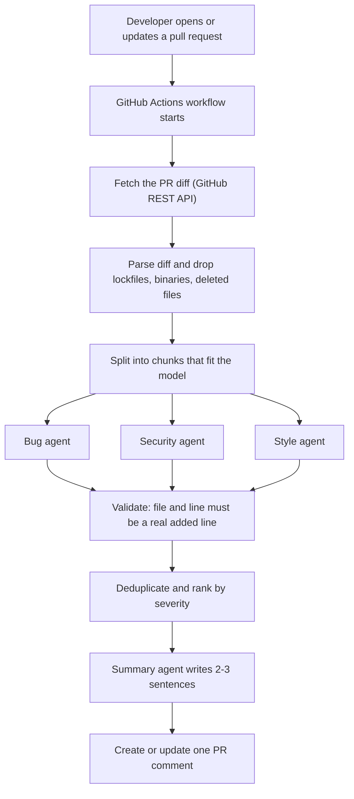

# PR Review Agent

An AI code reviewer for GitHub pull requests, built on **Google Gemini**. When a pull request is opened or updated, three specialist agents (bugs, security, style) review the changed code. Their findings are checked against the real diff, merged, and posted as a single comment on the PR.

It runs as a **GitHub Action**, so there is no server to host. On a public repo with a free Gemini API key it costs nothing.

---

## Table of contents

1. [The problem it solves](#the-problem-it-solves)
2. [Architecture](#architecture)
3. [How a review works, step by step](#how-a-review-works-step-by-step)
4. [Design decisions](#design-decisions)
5. [Example output](#example-output)
6. [Evaluation results](#evaluation-results)
7. [Setup](#setup)
8. [Run it locally](#run-it-locally)
9. [Configuration](#configuration)
10. [Project layout](#project-layout)
11. [Limitations](#limitations)
12. [Roadmap](#roadmap)

---

## The problem it solves

Code review is slow, and obvious mistakes (SQL injection, unclosed files, hardcoded secrets) often slip through when a reviewer is rushed. This project gives every pull request a fast first-pass review within minutes of opening it, so human reviewers can focus on design and logic.

The hard part of using an LLM for review is **trust**: models invent line numbers, flag correct code, and fail unpredictably. Most of this project's code exists to handle that: validating every finding, limiting cost, and degrading gracefully when the API misbehaves.

---

## Architecture



### Components

| Module | Responsibility |
|---|---|
| `.github/workflows/pr-review.yml` | Triggers on pull requests, installs dependencies, runs the agent with secrets |
| `reviewer/main.py` | Command-line entry point; picks the PR from the Actions event or a local diff file |
| `reviewer/github_client.py` | Fetches the PR diff and creates or updates the bot's comment |
| `reviewer/diff_utils.py` | Parses unified diffs, numbers lines, filters files, splits large files into chunks |
| `reviewer/agents.py` | The three agent prompts, the summary prompt, and validation of model output |
| `reviewer/llm.py` | Gemini wrapper: JSON output, timeouts, retries with backoff, rate-limit delay |
| `reviewer/orchestrator.py` | Runs the pipeline, enforces limits, merges and ranks findings |
| `reviewer/report.py` | Renders the markdown comment |
| `evaluation/` | Seeded-bug benchmark and scoring script |
| `tests/` | Unit tests using a fake LLM, so they need no API key or network |

---

## How a review works, step by step

1. **Trigger.** A pull request is opened, updated or reopened. The workflow runs on a GitHub-hosted machine.
2. **Fetch.** `github_client.py` downloads the PR's unified diff from the GitHub API.
3. **Parse and filter.** `diff_utils.py` splits the diff by file and skips lockfiles, images, binaries and deleted files. Every remaining line is labelled with its **line number in the new version of the file**, so the model can cite exact lines.
4. **Chunk.** Diffs are packed into chunks of at most 24,000 characters. A single oversized file is split across chunks.
5. **Run three agents.** Each chunk is sent to Gemini three times with different instructions:
   - **Bug agent:** logic errors, off-by-one, null dereferences, resource leaks, mutable default arguments, swallowed exceptions
   - **Security agent:** SQL and command injection, hardcoded secrets, path traversal, unsafe `eval`/`exec`, weak crypto
   - **Style agent:** unclear names, dead code, duplication, missing docstrings (formatting is left to linters)

   All three share the same code and differ only in their prompt. Each agent returns structured JSON.
6. **Validate.** Every finding must name a file in the diff and a line that was actually added. Invented files are dropped. A line number that is slightly off snaps to the nearest added line (within 3 lines); otherwise the finding is dropped. Unknown severities become `low`.
7. **Merge.** Duplicates are removed (the same issue raised by two agents keeps the most severe copy), then findings are ranked by severity and capped at 15.
8. **Summarize.** A fourth model call writes a short summary. If it fails, a deterministic summary is used instead.
9. **Post.** The report is posted as one PR comment. A hidden marker in the comment lets the bot find and **update** it on later pushes instead of adding a new one each time.

A small PR costs about 4 model calls (3 agents plus the summary) and takes roughly 30 seconds, most of it spent respecting the free tier's rate limit.

---

## Design decisions

| Decision | Why |
|---|---|
| **Three focused agents instead of one** | A prompt narrowed to one concern finds more than a general "review everything" prompt, and the results are easier to categorize |
| **Validate findings against the diff** | Models invent line numbers. Checking each citation against the parsed diff removes hallucinated findings before anyone sees them |
| **Line-numbered diff input** | Gives the model exact lines to cite and gives the validator something to verify against |
| **Conservative prompts** ("if unsure, report nothing") | An empty result is better than a noisy one; reviewers stop reading noisy bots |
| **Hard limits on calls, files, chunks and findings** | Keeps cost and runtime bounded on huge PRs |
| **Retries with backoff, but fail fast on 400/401/403/404** | Busy-server errors (503, 504, 429) are worth retrying; a wrong model name or bad key is not |
| **One failing agent does not fail the review** | The other agents still report, and the error is listed in the comment |
| **Diff treated as untrusted data** | The prompt tells the model to ignore instructions inside code or comments, which reduces prompt-injection risk |
| **Idempotent comment via hidden marker** | One tidy comment per PR, updated in place |
| **GitHub Action instead of a server** | No hosting, no uptime to manage, scales with PR volume |
| **Never fails the build** | The bot comments; it does not block merges. A wrong AI verdict should not stop a release |
| **Skips quietly with no API key** | Pull requests from forks do not receive secrets, so the run exits cleanly |

---

## Example output

The bot posts a comment shaped like this:

> ## 🤖 Automated PR Review
>
> Found 2 issues: 1 critical, 1 medium. The most serious is a command injection in `ping`.
>
> | 🔴 critical | 🟠 high | 🟡 medium | 🔵 low |
> |---|---|---|---|
> | 1 | 0 | 1 | 0 |
>
> - 🔴 **CRITICAL** · `demo.py:4` · _security_ — **Command injection via os.system**
>   User-controlled `host` is concatenated into a shell command.
>   💡 Use `subprocess.run([...])` with an argument list and validate the input.
> - 🟡 **MEDIUM** · `demo.py:4` · _bug_ — **Return value of os.system ignored**
>   ...
>
> <sub>Reviewed 1 file(s) with gemini-3.1-flash-lite · 4 model call(s) · AI-generated, so verify before acting.</sub>

*(Add a real screenshot of your own PR here once you have one.)*

---

## Evaluation results

`python -m evaluation.run_eval` runs the agents on 10 small Python files: 8 with one seeded bug each, and 2 correct files. A seeded bug counts as detected if any finding lands within 2 lines of it. A clean file counts as a false positive if it gets any finding of medium severity or higher.

| Metric | Result |
|---|---|
| Seeded bugs detected | **8 / 8** |
| Clean files wrongly flagged | **1 / 2** |
| Model calls | 30 |
| Total time | 618 s (mostly rate-limit delays and retries after temporary 503/504 errors) |
| Model | `gemini-3.1-flash-lite` (free tier) |

The seeded bugs are: SQL injection, hardcoded secret, off-by-one, mutable default argument, swallowed exception, `None` dereference, resource leak and command injection.

**Read these numbers with care.** The benchmark is small and the bugs are textbook examples written by the project author, so 8/8 does not mean the tool catches 100% of real bugs. The false positive on a clean file shows it can still over-report. Results also vary slightly between runs because the model is not deterministic. Extending the benchmark to 20-30 cases, including more clean files, is on the roadmap.

---

## Setup

You need a GitHub account and a free Gemini API key. About 10 minutes.

1. **Get a key** at <https://aistudio.google.com/apikey>.
2. **Push this project** to a GitHub repository. The bot reviews pull requests made against that repository.
3. **Add the key as a secret:** in the repo go to **Settings → Secrets and variables → Actions → New repository secret**. Name it `GEMINI_API_KEY` and paste the key.
4. **Allow the bot to comment:** in **Settings → Actions → General → Workflow permissions**, choose *Read and write permissions* if comments fail with a 403 error.
5. **Pick a model** in `.github/workflows/pr-review.yml` by setting `GEMINI_MODEL` (the workflow uses `gemini-3.1-flash-lite`). Free-tier model names change, so see [Configuration](#configuration) if you get a 404.
6. **Open a pull request.** Check the **Actions** tab to watch the run; the review comment appears on the PR within a few minutes.

To use it on a different repository, copy `reviewer/`, `requirements.txt` and the workflow file into that repository.

> Never put your API key in a file. Keep it in GitHub Secrets for the Action and in an environment variable on your computer. Push protection will also block commits that contain strings that look like real keys.

---

## Run it locally

You do not need GitHub to try the reviewer. It can review any diff file.

**Windows (PowerShell)**

```powershell
python -m venv .venv
.venv\Scripts\Activate.ps1
pip install -r requirements-dev.txt

$env:GEMINI_API_KEY="your-key"
$env:GEMINI_MODEL="gemini-3.1-flash-lite"

git diff > my.diff
python -m reviewer.main --diff-file my.diff
```

**macOS / Linux**

```bash
python -m venv .venv && source .venv/bin/activate
pip install -r requirements-dev.txt

export GEMINI_API_KEY="your-key"
export GEMINI_MODEL="gemini-3.1-flash-lite"

git diff > my.diff
python -m reviewer.main --diff-file my.diff
```

Other commands:

```bash
python -m pytest                 # unit tests, no key or network needed
python -m evaluation.run_eval    # benchmark; takes a few minutes on the free tier
```

Environment variables set with `$env:` or `export` last only for that terminal window. Use `setx` (Windows) or your shell profile to keep them. The project does not read `.env` files.

**Docker**

```bash
docker build -t pr-review-agent .
docker run --rm -e GEMINI_API_KEY=... -e GITHUB_TOKEN=... pr-review-agent --repo owner/name --pr 1
```

---

## Configuration

All settings are environment variables.

| Variable | Default | Meaning |
|---|---|---|
| `GEMINI_API_KEY` | none | Required. Without it the run exits without reviewing |
| `GEMINI_MODEL` | see `reviewer/config.py` | Model to use. Free-tier model names change; set this if you get a 404 |
| `REQUEST_DELAY_SECONDS` | `6` | Pause between calls to stay under free-tier rate limits |
| `MAX_RETRIES` | `4` | Attempts per call for temporary errors |
| `LLM_TIMEOUT_SECONDS` | `60` | Per-call timeout |
| `MAX_LLM_CALLS` | `14` | Hard step limit per PR |
| `MAX_FILES` / `MAX_CHUNKS` / `MAX_FINDINGS` | `25` / `4` / `15` | Size limits |
| `MAX_CHUNK_CHARS` | `24000` | Diff characters per model call |
| `USE_LLM_SUMMARY` | `1` | Set to `0` to skip the summary call |

**Choosing a model.** List the models your key can use:

```bash
python -c "import os; from google import genai; c=genai.Client(api_key=os.environ['GEMINI_API_KEY']); [print(m.name) for m in c.models.list()]"
```

A model appearing in the list does not guarantee free access. Smaller "flash-lite" models are usually the cheapest and least congested. Temporary `503` errors mean Google is busy; the agent retries automatically.

---

## Project layout

```
pr-review-agent/
├── .github/workflows/pr-review.yml   GitHub Action definition
├── reviewer/
│   ├── main.py            CLI entry point
│   ├── github_client.py   fetch diff, create or update comment
│   ├── diff_utils.py      parse, number, filter and chunk diffs
│   ├── agents.py          agent prompts and output validation
│   ├── llm.py             Gemini wrapper with retries and rate limiting
│   ├── orchestrator.py    pipeline, limits, merge and rank
│   ├── report.py          markdown comment renderer
│   ├── config.py          settings from environment variables
│   └── models.py          Finding and ReviewResult types
├── evaluation/
│   ├── cases.py           seeded-bug test cases
│   └── run_eval.py        benchmark runner
├── tests/                 unit tests with a fake LLM
├── Dockerfile
├── requirements.txt
└── requirements-dev.txt
```

---

## Limitations

- **Diff only.** It sees the changed lines, not the whole repository, so it can miss problems that span files.
- **It can be wrong.** It missed nothing on the small benchmark but flagged a correct file once. Treat findings as suggestions.
- **Free-tier constraints.** Rate limits and model availability change, and Google may use free-tier content to improve its products. Do not run it on private or employer code with a free key.
- **Forks.** Pull requests from forks get no review, because GitHub withholds secrets from them.
- **Small benchmark.** The evaluation is 10 hand-written cases, not a measure of real-world accuracy.

---

## Roadmap

- Inline comments on the exact changed lines using the pull request review API
- A larger benchmark (20-30 cases) with more clean files and real-world bugs
- Fetch surrounding file context for each finding to reduce false positives
- A "missing tests" agent
- Token and cost tracking per PR, plus tracing (Langfuse or OpenTelemetry)
- Skip PRs labelled `no-review`